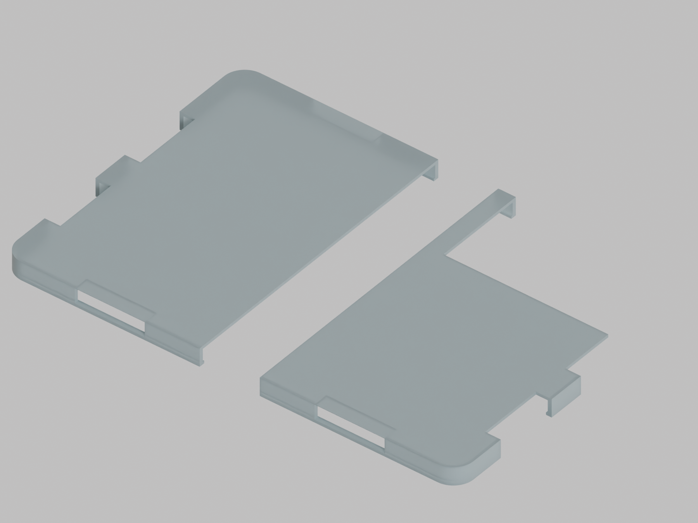

# null-iphone-duo-case — Basic B01

**まずはシンプルな2ピース透明TPU保護ケース。実機適合未検証・印刷リリースではありません。**

AirTag・PaperDIY・電子部品ポケットを外し、カメラ開口、側面ボタン窓、上下の端子用開口、ヒンジ側の逃げ、前面リップだけを持つ最小構成にしました。下の画像は実際のBlenderケースメッシュをIBLでレンダーしたCGです。実物写真でも印刷済み部品でもありません。半透明の見た目はELEGOO TPU95Aの実測光学特性ではありません。



## ファイル

- [カメラ側STL](design/stl/Basic_camera-side_shell.stl)
- [反対側STL](design/stl/Basic_opposite-side_shell.stl)
- [ケース部品のみの編集用Blender](design/case_parts_mm.blend)
- [形状生成スクリプト](src/build_case.py)
- [印刷・材料・プレート・剥離ガイド](docs/PRINT_GUIDE_JA.md)
- [参照モデルの取得手順](docs/REFERENCES.md)
- [寸法と検証範囲](docs/DIMENSIONS_AND_VALIDATION.md)

STLはmm、組立座標です。底面をZ=0へ移動しておらず、印刷姿勢・サポートは未設定です。Blenderは1単位=1mm。Blender 4.4.1で生成しました。

```sh
blender -b -t 6 --python src/build_case.py
# HDRIは別途取得し、絶対パスを渡す（画像のみ出力）
blender -b -t 6 --python src/render_case_only.py -- /path/to/studio_small_09_4k.exr
```

現時点の形状パラメータは `src/build_case.py` にあります。外形や開口は実測前の仮寸法で、公式ARモデルは製造公差CADではありません。2ピースのケースがヒンジをまたぐ接続はありません。抜き差し荷重、ボタン操作、USBプラグ・音孔の到達性、柔軟スクリーン・全ヒンジ軌道、実機曲率、落下、熱、RF、音響、水密、収縮、層間強度は未検証です。

## 検証

各部品の単一連結、非多様体エッジ0、正体積を確認しました。公式Apple ARモデルに重ねた開160度・閉状態の2姿勢で表面三角形交差を確認しています。判定記録は `validation/` にあります。表面交差0だけでは包含、動作中の衝突、実機適合、保持力や印刷成功を証明しません。印刷・プリンター操作は行っていません。

AppleのUSDZや、それを含む装着シーンの `.blend` は同梱していません。公開プレビューも独自ケース部品のみです。公式モデルとの重ね合わせ画像・作業シーンは別の私的作業成果として保存しています。取得・重ね合わせの注意は[参照手順](docs/REFERENCES.md)を参照してください。

## 将来候補

[archive/R04](archive/R04/) にAirTag・PaperDIY追加機能版の独自ケース設計を保存しています。現時点の主成果はBasicです。追加機能版も実機未検証で、Basicの印刷や適合の証拠ではありません。

## 権利と出典

このリポジトリでは新規の一括ライセンスを設定していません。第三者素材へ独自ライセンスを適用しません。Apple、M5Stack、ELEGOO、Bambu Lab等の名称・参照資料の権利は各権利者に帰属します。公式製品・認定アクセサリーではありません。

IBL出典: [Poly Haven Studio Small 09](https://polyhaven.com/a/studio_small_09)、Sergej Majboroda、[CC0](https://polyhaven.com/license)。HDRIファイルは同梱していません。
